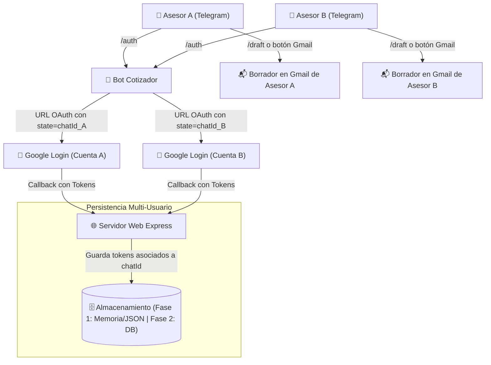

# 🚀 Plan de Mejoras Futuras — Bot Cotizador JP Solutions

Este documento recopila las propuestas de evolución, nuevas funcionalidades y optimizaciones técnicas planificadas para el sistema de cotizaciones por Telegram.

---

## 📌 1. Soporte Multi-Usuario con Cuentas de Correo Propias

### 🎯 Objetivo
Permitir que distintos asesores comerciales o miembros del equipo utilicen el bot de Telegram desde sus propias cuentas y que los borradores de Gmail se creen directamente en sus respectivas casillas de correo personales o corporativas (ej. `asesor1@jpsolutions.online`, `asesor2@jpsolutions.online`), en lugar de canalizarse todos a través de una única cuenta central.

---

### ⚙️ Arquitectura Propuesta



---

### 🛠️ Fases de Implementación

#### Fase 1: Implementación Inicial (Sin Base de Datos Externa)
* **Mapeo en memoria y archivo JSON local (`user_tokens.json`):**
  * Indexar credenciales OAuth utilizando el identificador único de chat de Telegram (`chatId` o `userId`).
  * Estructura de datos:
    ```json
    {
      "123456789": {
        "email": "carlos@jpsolutions.online",
        "refresh_token": "1//0abc...",
        "access_token": "ya29...",
        "expires_at": 1792085829837
      },
      "987654321": {
        "email": "maria@jpsolutions.online",
        "refresh_token": "1//0xyz...",
        "access_token": "ya29...",
        "expires_at": 1792085829837
      }
    }
    ```
* **Flujo OAuth2 con parámetro `state`:**
  * Al invocar `/auth`, el bot construye la URL de autorización pasando `state = ctx.chat.id`.
  * La ruta `/oauth2callback` recupera el `state` devuelto por Google y asocia el `refresh_token` a ese usuario exacto.
* **Fallback transparente:**
  * Si un usuario nuevo aún no se ha vinculado mediante `/auth`, el bot le avisa amablemente antes de generar el borrador:
    > *"⚠️ Aún no has vinculado tu cuenta de Gmail. Usa el comando /auth para autorizar tu correo."*
  * Como respaldo general, si existe la variable global `GMAIL_REFRESH_TOKEN`, se puede usar como cuenta predeterminada del sistema.

#### Fase 2: Persistencia Robusta con Base de Datos en la Nube
Debido a que entornos como Render poseen sistemas de archivos efímeros (los archivos locales se restablecen al desplegar nuevo código o reiniciar el contenedor), en la siguiente etapa se incorporará una base de datos gestionada:

* **Opción recomendada:** **Supabase** (PostgreSQL Serverless gratuito) o **Upstash Redis**.
* **Esquema de tabla sugerido (`asesores_gmail`):**
  * `telegram_id` (BIGINT, PRIMARY KEY)
  * `email` (TEXT)
  * `refresh_token` (TEXT)
  * `created_at` (TIMESTAMP)
  * `updated_at` (TIMESTAMP)

---

### 🔒 Requisitos en Google Cloud Console
* No se requieren múltiples aplicaciones OAuth ni duplicar variables de entorno en el servidor (`GOOGLE_CLIENT_ID` y `GOOGLE_CLIENT_SECRET` siguen siendo únicos y compartidos).
* En la pantalla de consentimiento de Google Cloud Console:
  * Si la aplicación está en modo de prueba (**Testing**): agregar los correos de los asesores autorizados en la sección *Test users* (hasta 100 usuarios).
  * Si se utiliza Google Workspace empresarial: configurar el tipo de usuario como **Internal** para permitir acceso sin restricciones a cualquier usuario del dominio de la empresa.

---

## 📋 2. Otras Mejoras en Consideración

1. **Personalización del Remitente en el PDF:**
   * Adaptar automáticamente el pie de página y datos de contacto del emisor en `pdfEngine.js` con el nombre, teléfono y correo del asesor logueado en Telegram.
2. **Historial de Cotizaciones Emitidas:**
   * Registro de cotizaciones generadas con número correlativo único persistido, fecha, cliente y montos para consulta histórica de cada asesor (`/historial`).
3. **Panel de Métricas y Estadísticas:**
   * Visualización de total cotizado por mes, tasa de conversión y servicios más demandados.
