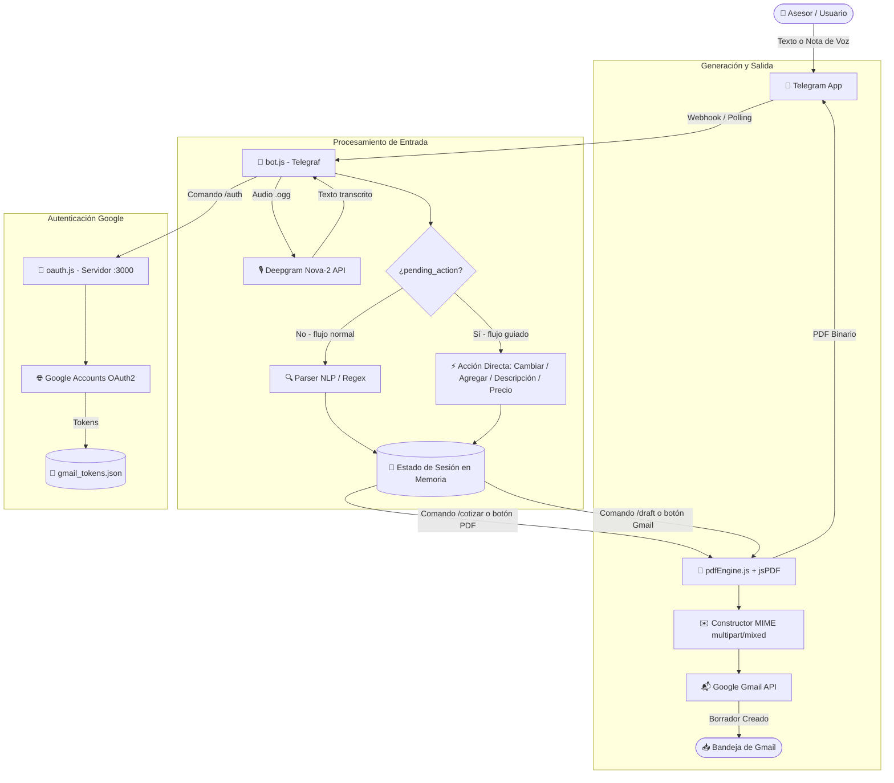

# 🤖 Bot Cotizador JP Solutions — Telegram

Sistema inteligente de cotización y propuestas comerciales a través de Telegram para **JP Solutions**. Permite recopilar información de clientes y servicios mediante **texto o notas de voz**, procesar los requerimientos de forma automática, generar documentos PDF profesionales con estándares de diseño corporativo y guardar borradores oficiales directamente en **Gmail** listos para ser enviados al cliente.

---

## 📑 Tabla de Contenidos
1. [Descripción General](#-descripción-general)
2. [Funcionalidad del Sistema](#-funcionalidad-del-sistema)
3. [Características Principales](#-características-principales)
4. [Stack Tecnológico](#-stack-tecnológico)
5. [Arquitectura y Flujo de Trabajo](#-arquitectura-y-flujo-de-trabajo)
6. [Requisitos Previos](#-requisitos-previos)
7. [Instalación y Configuración](#-instalación-y-configuración)
8. [Comandos y Uso del Bot](#-comandos-y-uso-del-bot)
9. [Botones Interactivos y Flujo Guiado](#-botones-interactivos-y-flujo-guiado)
10. [Estructura del Proyecto](#-estructura-del-proyecto)
11. [Catálogo de Servicios](#-catálogo-de-servicios)
12. [Consideraciones de Red y Despliegue](#-consideraciones-de-red-y-despliegue)
13. [Despliegue en la Nube (Render 24/7 y Alta Disponibilidad)](#-despliegue-en-la-nube-render-247-y-alta-disponibilidad)

---

## 🎯 Descripción General

El **Bot Cotizador** simplifica el proceso de ventas para el equipo comercial de JP Solutions. En lugar de llenar formularios complejos o redactar documentos manualmente, el vendedor o consultor simplemente envía un mensaje de texto o una nota de voz en lenguaje natural por Telegram describiendo la cotización (cliente, empresa, correo, servicios solicitados, descuentos y condiciones).

El bot extrae los datos, actualiza el estado de la cotización, permite validar el resumen en tiempo real y produce:
1. **Un documento PDF formal**, con estética idéntica a la plataforma web de JP Solutions, numeración única y código de verificación criptográfica SHA-256.
2. **Un borrador automático en Gmail** con cuerpo HTML formateado y el PDF adjunto, dirigido al correo del cliente.

---

## ⚙️ Funcionalidad del Sistema

### 1. Entrada Multimodal (Texto y Voz)
* **Recepción de mensajes de texto**: Extrae parámetros clave aunque vengan en oraciones informales.
* **Procesamiento de notas de voz (.ogg)**: Descarga el audio de Telegram, lo envía a la API de **Deepgram Nova-2** y procesa la transcripción textual resultante.

### 2. Procesamiento de Lenguaje Natural (NLP Heurístico / Regex)
* **Normalización fonética de correo**: Reconoce dictados hablados de emails como `"juan arroba gmail punto com"` y los convierte a correos válidos (`juan@gmail.com`).
* **Extracción de entidades**:
  * **Cliente**: Detecta prefijos como *al señor, a la señora, don, doña, para, contacto, cliente*.
  * **Empresa / Negocio**: Detecta sufijos y prefijos comerciales como *del restaurante, ferretería, inversiones, clínica, tienda, de la empresa*, etc.
  * **Correo electrónico**: Detección y validación de formatos de email y dominios habituales.
  * **Teléfono y Dirección**: Extracción de números telefónicos y direcciones físicas mencionadas.
  * **Servicios solicitados**: Mapeo inteligente de palabras clave hacia los ítems del catálogo (`servicios.json`). Soporta además servicios **fuera del catálogo** mediante extracción de texto libre.
  * **Descuentos**: Detección de porcentajes (ej. `"15%"`, `"10 por ciento de descuento"`).
  * **Notas y Observaciones**: Captura instrucciones especiales o acuerdos adicionales.
* **Memoria conversacional y acumulación de datos**: Permite enviar datos en múltiples mensajes o notas de voz consecutivas. Al detectar frases como *"nueva cotización"* o *"vamos a hacer una cotización"*, reinicia el estado automáticamente.
* **Máquina de estados guiada por botones**: Cuando el usuario presiona un botón de acción (cambiar servicio, agregar servicio, modificar descripción, indicar monto), el bot activa un estado de espera (`pending_action`) para interpretar el siguiente mensaje **exclusivamente en ese contexto**, garantizando precisión sin ambigüedad.

### 3. Gestión de Servicios con Nombre Literal
* Al usar los botones **🔄 Cambiar Servicio** o **➕ Agregar Servicio**, el bot usa el texto escrito o dictado **tal cual** como nombre del servicio, sin intentar mapearlo al catálogo ni cambiar el nombre por uno predefinido.
* El precio existente se **preserva automáticamente** al cambiar el nombre del servicio, a menos que el usuario especifique uno nuevo en el mismo mensaje (ej: `"Chatbot \$300"`).
* La **descripción** también se preserva al cambiar el nombre del servicio.

### 4. Generación Dinámica de PDF Vectorial (`pdfEngine.js`)
* Generación instantánea en memoria (sin dependencias de navegadores externos tipo Puppeteer).
* Inclusión de fuentes TrueType corporativas (Arial base64) y logotipo oficial.
* Gradientes lineales corporativos (`#3b82f6` a `#8b5cf6`).
* Desglose de servicios, precios unitarios, subtotales, cálculo de descuentos y total final en USD.
* **Código de seguridad criptográfico**: Hash de 20 dígitos generado mediante `SHA-256` y sal secreta para garantizar autenticidad e impedir falsificaciones.
* Paginación inteligente (`ensure`) con encabezados de continuación y pie de página institucional.
* Cláusulas comerciales y legales automáticas (servicios no incluyen impuestos, moneda USD, tasa de cambio según BCV, validez de 7 días hábiles).

### 5. Integración Directa con Gmail API (`oauth.js`)
* Creación de borradores oficiales (`/draft`) en la cuenta corporativa de Gmail mediante la API de Google Workspace.
* Construcción nativa de mensajes MIME `multipart/mixed` compatibles con el estándar RFC 2047.
* Adjunto del PDF generado y cuerpo HTML con plantilla moderna y responsive.
* Flujo de autenticación OAuth2 seguro con servidor web en puerto `3000`, pantalla de confirmación y auto-renovación silenciosa de `access_token` usando `refresh_token`.

---

## ✨ Características Principales

* 🎙️ **Soporte de Voz de Alta Velocidad**: Transcripción casi instantánea en español con Deepgram Nova-2.
* 🧠 **Extracción Inteligente sin Latencia**: Motor de reglas y expresiones regulares sin dependencia de LLMs lentos o costosos.
* 🔄 **Máquina de Estados por Botón**: El bot "recuerda" qué está esperando tras cada botón pulsado, evitando interpretaciones ambiguas.
* ✏️ **Edición Precisa de Servicios**: Cambiar o agregar servicios con nombre literal exacto, sin que el bot lo modifique o renombre.
* 💰 **Preservación de Precio**: Al cambiar el nombre de un servicio, el precio se mantiene automáticamente.
* 📝 **Cambio Directo de Descripción**: Pulsa el botón y dicta o escribe la descripción libremente, sin prefijos especiales.
* 📄 **PDFs Corporativos de Alta Fidelidad**: Diseño idéntico al cotizador web, con branding, tablas estilizadas y tipografía embebida.
* 🔐 **Seguridad Anti-adulteración**: Cada cotización incluye un código numérico de 20 dígitos verificado por hash criptográfico.
* 📧 **Ahorro de Tiempo en Correo**: El borrador queda listo en Gmail con un solo clic.
* 🔄 **Tolerancia a Fallos y Reintentos**: Reconexión automática infinita con Telegram si ocurren caídas temporales de red.
* 🌐 **Soporte de Proxies**: Compatibilidad con proxies HTTP/HTTPS y endpoints personalizados para operar en regiones con bloqueos (Venezuela).
* 📦 **Catálogo Modular**: Precios y descripciones configurables en `servicios.json` sin modificar código fuente.

---

## 🛠️ Stack Tecnológico

| Capa / Componente | Tecnología | Descripción / Propósito |
| :--- | :--- | :--- |
| **Runtime** | **Node.js** (v18+) | Entorno de ejecución en JavaScript asíncrono. |
| **Framework del Bot** | **Telegraf** (v4.16.3) | Framework para la API de bots de Telegram con soporte de middleware y comandos. |
| **Speech-to-Text (STT)** | **Deepgram Nova-2 API** | Transcripción de notas de voz en español con modelo de baja latencia y alta precisión. |
| **Generación de PDF** | **jsPDF** (v4.2.1 / v2.5+) | Creación vectorial en memoria de documentos PDF (fuentes personalizadas, tablas y gráficos). |
| **Email & Google APIs** | **Google Gmail REST API (v1)** | Gestión de borradores vía HTTPS con OAuth 2.0 y soporte de `refresh_token`. |
| **Servidor de Autenticación** | **Express + Node.js** | Servidor web en puerto `3000` para resolver el callback OAuth2 de Google y health check. |
| **Procesamiento MIME** | **Buffer & RFC 2047 nativo** | Ensamblado manual de correos `multipart/mixed` codificados en Base64url. |
| **Criptografía** | **Node.js `crypto` nativo** | Generación de hashes `SHA-256` con sal secreta para códigos de seguridad. |
| **Configuración** | **dotenv** | Carga de credenciales y variables de entorno desde `.env`. |
| **Gestor de Procesos** | **PM2** *(recomendado local)* | Monitoreo, reinicio automático y ejecución daemon en producción local. |

---

## 📐 Arquitectura y Flujo de Trabajo



---

## 📋 Requisitos Previos

### 1. Entorno de Ejecución
* **Node.js**: Versión 18.0.0 o superior (`node -v`).
* **npm**: Versión 9 o superior (`npm -v`).
* Conexión a internet hacia:
  * `api.telegram.org` (Telegram Bot API).
  * `api.deepgram.com` (Deepgram API).
  * `accounts.google.com` y `gmail.googleapis.com` (Google OAuth & Gmail API).

> **Nota para despliegues en Venezuela:** Debido a bloqueos de proveedores de internet (CANTV/móviles), se recomienda ejecutar el bot en un VPS externo o configurar las variables `HTTPS_PROXY` / `TELEGRAM_API_ROOT`.

### 2. Credenciales y Cuentas Necesarias
1. **Token del Bot de Telegram**: Obtenido desde [@BotFather](https://t.me/BotFather).
2. **Deepgram API Key**: Creada en [Deepgram Console](https://console.deepgram.com/).
3. **Google Cloud Console**:
   * Proyecto creado con la **Gmail API** habilitada.
   * Pantalla de consentimiento OAuth configurada con scope `https://www.googleapis.com/auth/gmail.compose`.
   * Credenciales de tipo **ID de cliente de OAuth 2.0 (Aplicación web)**.
   * **URI de redirección autorizada**:
     * Desarrollo local: `http://localhost:3000/oauth2callback`
     * Producción: `https://tu-dominio.onrender.com/oauth2callback`

---

## 🚀 Instalación y Configuración

### 1. Clonar o descargar el repositorio
```bash
git clone https://github.com/emailjpsolutions-eng/TelegramCotizador.git
cd TelegramCotizador
```

### 2. Instalar dependencias
```bash
npm install
```

### 3. Configurar variables de entorno (`.env`)
Crea un archivo `.env` en la raíz del proyecto basándote en `.env.example`:

```env
# Credenciales Obligatorias
BOT_TOKEN=tu_token_de_telegram
DEEPGRAM_API_KEY=tu_api_key_de_deepgram
GOOGLE_CLIENT_ID=tu_cliente_id.apps.googleusercontent.com
GOOGLE_CLIENT_SECRET=tu_cliente_secret

# Datos Corporativos del Emisor (Opcionales - con defaults en código)
JP_EMAIL=info@jpsolutions.online
JP_TEL=0414-3325600

# Parámetros de Red / Proxy (Opcionales para entornos con bloqueo)
# HTTPS_PROXY=http://127.0.0.1:1080
# TELEGRAM_API_ROOT=https://tu-proxy-telegram.com
```

### 4. Autorizar la cuenta de Gmail
1. Inicia el bot (`node bot.js`).
2. Abre Telegram y escribe el comando `/auth` a tu bot.
3. Abre el enlace proporcionado y acepta los permisos de Gmail.
4. Los tokens se almacenarán automáticamente en `gmail_tokens.json` y se renovarán de forma transparente.

### 5. Ejecutar la aplicación

#### En Desarrollo:
```bash
node bot.js
```

#### En Producción (con PM2):
```bash
npm install -g pm2
pm2 start bot.js --name "jp-cotizador-bot" --time
pm2 save
pm2 startup
```

---

## 💬 Comandos y Uso del Bot

### Comandos Disponibles

| Comando | Acción |
| :--- | :--- |
| `/start` | Reinicia la sesión de cotización y muestra el mensaje de bienvenida. |
| `/cotizar` | Genera directamente el archivo PDF formal y lo envía al chat de Telegram. |
| `/draft` | Genera la cotización y crea un borrador oficial en Gmail con el PDF adjunto. |
| `/auth` | Inicia el portal web para vincular o renovar la cuenta de Gmail vía Google OAuth. |

### Ejemplos de Mensajes Válidos (Texto o Voz):

> *"Nueva cotización para el señor Carlos Mendoza de la empresa Ferretería La Principal, correo carlos@ferreteria.com, teléfono 0412-1234567. Necesitan una landing page y dos agentes de inteligencia artificial con un 10 por ciento de descuento."*

> *"Para el Restaurant Lee Hamilton, ellos quieren un CRM para registrar sus clientes, el señor Ricardo arroba gmail punto com."*

> *"Cotización para Farmacia Central, señor Pedro, servicio de instalación de cámaras de seguridad por $250."*

### Servicios Personalizados Fuera del Catálogo:
Si el servicio no figura en `servicios.json`, el bot lo registra automáticamente:
* **Con monto:** *"realizarle un diseño de logo por $120"* → registra inmediatamente a $120 USD.
* **Sin monto:** *"quieren un sistema de inventario"* → registra con monto pendiente y solicita el precio con el botón `[💰 Indicar Monto]`.

---

## 🎛️ Botones Interactivos y Flujo Guiado

El bot utiliza una **máquina de estados** con botones de acción. Al pulsar cualquier botón, el bot activa un modo de espera (`pending_action`) para interpretar el siguiente mensaje con precisión:

### Teclado de Confirmación

| Botón | Acción |
| :--- | :--- |
| ✅ **Confirmar Datos** | Confirma la cotización y muestra las opciones de salida (PDF / Gmail). |
| 🔄 **Cambiar Servicio** | **Reemplaza** el servicio actual por el que escribas o dictes. El nombre se toma **literalmente** (no mapea al catálogo). El precio existente se preserva. |
| ➕ **Agregar Servicio** | **Añade** un nuevo servicio a la lista sin borrar los existentes. El nombre se toma **literalmente**. |
| 📝 **Cambiar Descripción** | Cambia la descripción del último servicio. Escribe o dicta directamente sin prefijos. |
| 💰 **Indicar Monto** | Asigna o actualiza el precio del servicio pendiente. |
| ✏️ **Más Opciones** | Modo libre para enviar correcciones adicionales en texto o voz. |
| ❌ **Descartar** | Cancela la cotización y reinicia el estado. |

### Comportamiento de 🔄 Cambiar Servicio

| Lo que escribes | Resultado |
| :--- | :--- |
| `Chatbot` | Servicio → **Chatbot** · Precio → *preservado del anterior* |
| `CRM + Chatbot` | Servicio → **CRM + Chatbot** · Precio → *preservado* |
| `Auditoría $250` | Servicio → **Auditoría** · Precio → **$250** |
| `Landing Page ;monto 200` | Servicio → **Landing Page** · Precio → **$200** |

### Teclado de Acciones (post-confirmación)

| Botón | Acción |
| :--- | :--- |
| 📄 **Generar y Enviar PDF** | Recibe el documento PDF en Telegram al instante. |
| 📧 **Guardar Borrador en Gmail** | Crea el borrador en Gmail con el PDF adjunto y cuerpo formal. |
| 🔄 **Iniciar Nueva Cotización** | Descarta y reinicia el estado. |

---

## 📁 Estructura del Proyecto

```
TelegramCotizador/
├── .env                  # Variables de entorno y llaves secretas (Ignorado en Git)
├── .env.example          # Plantilla de referencia para variables de entorno
├── .gitignore            # Reglas de exclusión para Git
├── assets/
│   └── pdfAssets.js      # Recursos embebidos en Base64 (Fuente Arial + Logo PNG)
├── auth_helper.html      # Portal web interactivo para autorización OAuth de Google
├── bot.js                # Lógica central: handlers Telegraf, parser NLP, máquina de estados y servidor Express
├── Documentacion.md      # Guía técnica complementaria de despliegue y servidores
├── gmail_tokens.json     # Almacenamiento local de tokens de acceso y refresco de Gmail
├── oauth.js              # Servidor OAuth2 de Google y gestión de tokens
├── package.json          # Metadatos del proyecto, scripts y dependencias
├── package-lock.json     # Árbol de versiones bloqueadas
├── pdfEngine.js          # Motor vectorial de maquetación de cotizaciones PDF (jsPDF)
├── README.md             # Esta documentación general del proyecto
└── servicios.json        # Catálogo configurable de servicios, descripciones y precios
```

---

## 🏷️ Catálogo de Servicios (`servicios.json`)

Los servicios reconocidos automáticamente por el parser NLP y sus tarifas base. Puedes modificar precios o descripciones sin alterar el código fuente:

```json
{
  "ai": {
    "nombre": "Agentes / Chatbot AI",
    "descripcion": "Implementación de Agente IA de Atención al Cliente",
    "precio": 500
  },
  "af": {
    "nombre": "Correo Corporativo / Automatización",
    "descripcion": "Configuración de cuentas de correo corporativo y flujos de automatización",
    "precio": 100
  },
  "lp": {
    "nombre": "Landing Page",
    "descripcion": "Diseño y desarrollo de página de aterrizaje profesional",
    "precio": 200
  },
  "md": {
    "nombre": "Desarrollo de aplicacion a la medida",
    "descripcion": "Desarrollo de software personalizado",
    "precio": 1200
  },
  "con": {
    "nombre": "Consultoría TI",
    "descripcion": "Consultoría tecnológica e inteligencia artificial",
    "precio": 300
  },
  "sop": {
    "nombre": "Soporte Técnico",
    "descripcion": "Soporte y mantenimiento de sistemas",
    "precio": 250
  },
  "gmb": {
    "nombre": "Análisis perfil Negocio",
    "descripcion": "Revisión y Análisis del perfil de Google My Business",
    "precio": 300
  },
  "crm": {
    "nombre": "Sistema CRM / Gestión de Clientes",
    "descripcion": "Implementación de CRM para gestión y seguimiento de clientes",
    "precio": 400
  }
}
```

> **Tip:** Para agregar un nuevo servicio al catálogo de reconocimiento automático (por voz/texto), agrégalo en `servicios.json` **y** registra su patrón de detección en el array `serviciosDisponibles` dentro de `bot.js`.

---

## 🌐 Consideraciones de Red y Despliegue

### Bloqueos de Proveedores de Internet (Venezuela)
* **Telegram API**: `api.telegram.org` suele experimentar bloqueos intermitentes de DNS/SNI.
* **Soluciones recomendadas**:
  1. Desplegar en un VPS externo (DigitalOcean, AWS, Hetzner, Oracle Cloud, etc.).
  2. Configurar una VPN con *Full Tunnel* (WireGuard u OpenVPN).
  3. Utilizar variables de proxy en `.env` (`HTTPS_PROXY=http://127.0.0.1:puerto`).

### Ciclo de Vida de Tokens Gmail
* La aplicación almacena el `refresh_token` de Google. Cuando el `access_token` expira (cada 60 minutos), `oauth.js` solicita automáticamente uno nuevo a Google sin interrumpir al usuario.
* Si el token es revocado manualmente, el bot notificará que se debe ejecutar `/auth` nuevamente.

---

## ☁️ Despliegue en la Nube (Render 24/7 y Alta Disponibilidad)

El bot está preparado para ejecutarse de forma ininterrumpida mediante un **Web Service de Render** conectado a GitHub.

### 1. Arquitectura de Alta Disponibilidad
* **Servidor Web Express Integrado (`bot.js`):** Escucha en el puerto dinámico asignado por Render (`process.env.PORT`) y responde con HTTP 200 en `/` y `/health`.
* **Persistencia de Tokens OAuth:** Soporte nativo para `GMAIL_REFRESH_TOKEN` en `oauth.js`, garantizando sesiones persistentes tras reinicios.
* **Tolerancia a Fallos:** Reintentos automáticos continuos hacia la API de Telegram con intervalos de 5 segundos.

### 2. Variables de Entorno en Producción

| Variable | Descripción |
| :--- | :--- |
| `BOT_TOKEN` | Token del bot provisto por BotFather en Telegram |
| `DEEPGRAM_API_KEY` | Clave API de Deepgram para transcripción de voz |
| `GOOGLE_CLIENT_ID` | Identificador de cliente OAuth 2.0 de Google Cloud Console |
| `GOOGLE_CLIENT_SECRET` | Clave secreta OAuth 2.0 de Google Cloud Console |
| `GMAIL_REFRESH_TOKEN` | Token de refresco permanente de Gmail para emitir borradores |
| `JP_EMAIL` | Correo corporativo del emisor (ej. `info@jpsolutions.online`) |

### 3. Despliegue Continuo (CI/CD Automático)
El servicio está vinculado al repositorio de GitHub:
`https://github.com/emailjpsolutions-eng/TelegramCotizador`

* **Comando de compilación (Build Command):** `npm install`
* **Comando de inicio (Start Command):** `node bot.js`
* **Auto-Deploy:** Al hacer `git push origin main`, Render detecta automáticamente las modificaciones y reinicia el bot sin intervención manual.

### 4. Estrategia Anti-Suspensión (Keep-Alive 24/7)
En la capa gratuita de Render, las instancias entran en modo reposo tras 15 minutos sin tráfico. Para mantener el bot operativo 24/7:
* Configurar una tarea programada en [cron-job.org](https://cron-job.org) o [UptimeRobot](https://uptimerobot.com).
* **Frecuencia:** Cada 10 minutos (`*/10 * * * *`).
* **Endpoint:** `GET https://tu-servicio.onrender.com/health`

---

**Desarrollado para JP Solutions**
*Automatización e Inteligencia Artificial*
🌐 [www.jpsolutions.online](https://www.jpsolutions.online) | ✉️ info@jpsolutions.online
