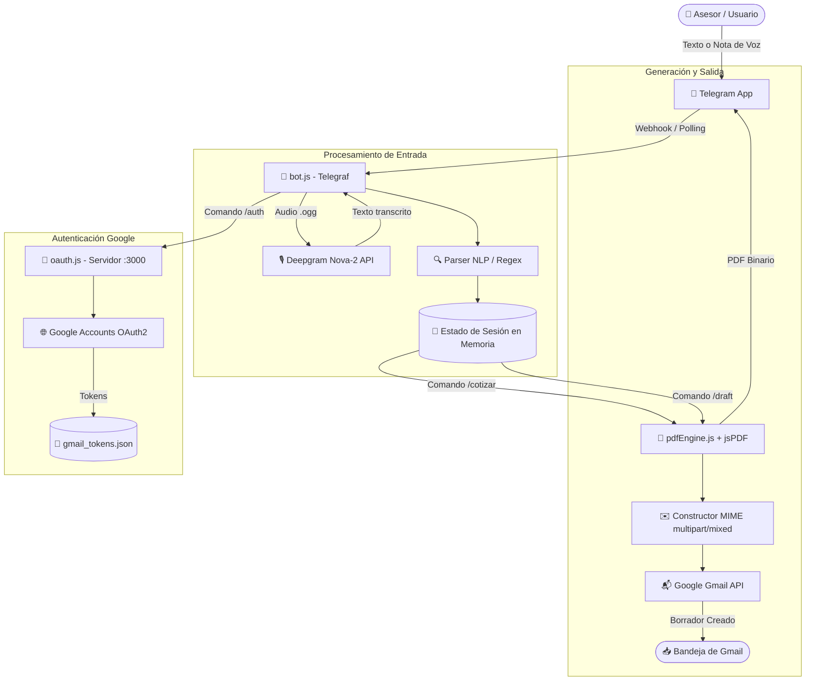

# 🤖 Bot Cotizador JP Solutions — Telegram

Sistema inteligente de cotización y propuestas comerciales a través de Telegram para **JP Solutions**. Permite recopilar información de clientes y servicios mediante **texto o notas de voz**, procesar los requerimientos de forma automática, generar documentos PDF profesionales con estándares de diseño corporativo y guardar borradores oficiales directamente en **Gmail** listos para ser enviados al cliente.

---

## 📑 Tabla de Contenidos
1. [Descripción General](#-descripción-general)
2. [Funcionalidad del Sistema](#-funcionalidad-del-sistema)
3. [Características Principales](#-características-principales)
4. [Stack Tecnológico](#-stack-tecnológico)
5. [Arquitectura y Flujo de Trabajo](#-arquitectura-y-flujo-de-trabajo)
6. [Requisitos Previos](#-requisitos-previos)
7. [Instalación y Configuración](#-instalación-y-configuración)
8. [Comandos y Uso del Bot](#-comandos-y-uso-del-bot)
9. [Estructura del Proyecto](#-estructura-del-proyecto)
10. [Catálogo de Servicios](#-catálogo-de-servicios)
11. [Consideraciones de Red y Despliegue](#-consideraciones-de-red-y-despliegue)

---

## 🎯 Descripción General

El **Bot Cotizador** simplifica el proceso de ventas para el equipo comercial de JP Solutions. En lugar de llenar formularios complejos o redactar documentos manualmente, el vendedor o consultor simplemente envía un mensaje de texto o una nota de voz en lenguaje natural por Telegram describiendo la cotización (cliente, empresa, correo, servicios solicitados, descuentos y condiciones).

El bot extrae los datos, actualiza el estado de la cotización, permite validar el resumen en tiempo real y produce:
1. **Un documento PDF formal**, con estética idéntica a la plataforma web de JP Solutions, numeración única y código de verificación criptográfica SHA-256.
2. **Un borrador automático en Gmail** con cuerpo HTML formateado y el PDF adjunto, dirigido al correo del cliente.

---

## ⚙️ Funcionalidad del Sistema

### 1. Entrada Multimodal (Texto y Voz)
* **Recepción de mensajes de texto**: Extrae parámetros clave aunque vengan en oraciones informales.
* **Procesamiento de notas de voz (.ogg)**: Descarga el audio de Telegram, lo envía a la API de **Deepgram Nova-2** y procesa la transcripción textual resultante.

### 2. Procesamiento de Lenguaje Natural (NLP Heurístico / Regex)
* **Normalización fonética de correo**: Reconoce dictados hablados de emails como `"juan arroba gmail punto com"` o `"contacto arroba miempresa dot com"` y los convierte a correos válidos (`juan@gmail.com`).
* **Extracción de entidades**:
  * **Cliente**: Detecta prefijos como *al señor, a la señora, don, doña, para, contacto, cliente*.
  * **Empresa / Negocio**: Detecta sufijos y prefijos comerciales como *del restaurante, ferretería, inversiones, clínica, tienda, de la empresa*, etc.
  * **Correo electrónico**: Detección y validación de formatos de email y dominios habituales.
  * **Teléfono y Dirección**: Extracción de números telefónicos y direcciones físicas mencionadas.
  * **Servicios solicitados**: Mapeo inteligente de palabras clave hacia los ítems del catálogo (`servicios.json`).
  * **Descuentos**: Detección de porcentajes (ej. `"15%"`, `"10 por ciento de descuento"`).
  * **Notas y Observaciones**: Captura instrucciones especiales o acuerdos adicionales.
* **Memoria conversacional y acumulación de datos**: Permite enviar datos en múltiples mensajes o notas de voz consecutivas (ej. enviar primero el cliente y luego agregar el correo y servicios). Al detectar frases como *"nueva cotización"* o *"vamos a hacer una cotización"*, reinicia el estado automáticamente.

### 3. Generación Dinámica de PDF Vectorial (`pdfEngine.js`)
* Generación instantánea en memoria (sin dependencias de navegadores externos tipo Puppeteer).
* Inclusión de fuentes TrueType corporativas (Arial base64) y logotipo oficial.
* Gradientes lineales corporativos (`#3b82f6` a `#8b5cf6`).
* Desglose de servicios, precios unitarios, subtotales, cálculo de descuentos y total final en USD.
* **Código de seguridad criptográfico**: Hash de 20 dígitos generado mediante `SHA-256` y sal secreta para garantizar autenticidad e impedir falsificaciones.
* Paginación inteligente (`ensure`) con encabezados de continuación y pie de página institucional.
* Cláusulas comerciales y legales automáticas (servicios no incluyen impuestos, moneda USD, tasa de cambio según Banco Central de Venezuela - BCV, validez de 7 días hábiles).

### 4. Integración Directa con Gmail API (`oauth.js`)
* Creación de borradores oficiales (`/draft`) en la cuenta corporativa de Gmail mediante la API de Google Workspace.
* Construcción nativa de mensajes MIME `multipart/mixed` compatibles con el estándar RFC 2047 (codificación UTF-8 Base64 para prevenir caracteres corruptos en asuntos o nombres de adjuntos).
* Adjunto del PDF generado y cuerpo HTML con plantilla moderna y responsive.
* Flujo de autenticación OAuth2 seguro con servidor web local en puerto `3000`, pantalla de confirmación (`auth_helper.html`) y auto-renovación silenciosa de `access_token` usando `refresh_token`.

---

## ✨ Características Principales

* 🎙️ **Soporte de Voz de Alta Velocidad**: Transcripción casi instantánea en español con Deepgram Nova-2.
* 🧠 **Extracción Inteligente sin Latencia**: Motor de reglas y expresiones regulares que no depende de LLMs lentos o costosos para parsear la información básica.
* 📄 **PDFs Corporativos de Alta Fidelidad**: Diseño idéntico al cotizador web, con branding, tablas estilizadas y tipografía embebida.
* 🔐 **Seguridad Anti-adulteración**: Cada cotización incluye un código numérico de 20 dígitos verificado por hash criptográfico.
* 📧 **Ahorro de Tiempo en Correo**: El borrador queda listo en la bandeja de salida de Gmail con destinatario, asunto, cuerpo formateado y PDF adjunto con un solo comando.
* 🔄 **Tolerancia a Fallos y Reintentos**: Reconexión automática infinita con Telegram si ocurren caídas temporales de red.
* 🌐 **Soporte de Proxies**: Compatibilidad con proxies HTTP/HTTPS y endpoints personalizados (`TELEGRAM_API_ROOT`) para operar en regiones con bloqueos de DNS o censura (Venezuela).
* 📦 **Catálogo Modular**: Precios y descripciones de servicios configurables directamente en `servicios.json` sin modificar el código fuente.

---

## 🛠️ Stack Tecnológico

| Capa / Componente | Tecnología | Descripción / Propósito |
| :--- | :--- | :--- |
| **Runtime** | **Node.js** (v18+) | Entorno de ejecución en JavaScript asíncrono. |
| **Framework del Bot** | **Telegraf** (v4.16.3) | Framework para la API de bots de Telegram con soporte de middleware y comandos. |
| **Speech-to-Text (STT)** | **Deepgram Nova-2 API** | Transcripción de notas de voz en español con modelo de baja latencia y alta precisión. |
| **Generación de PDF** | **jsPDF** (v4.2.1 / v2.5+) | Creación vectorial en memoria de documentos PDF (fuentes personalizadas, tablas y gráficos). |
| **Email & Google APIs** | **Google Gmail REST API (v1)** | Gestión de borradores vía HTTPS con OAuth 2.0 y soporte de `refresh_token`. |
| **Servidor de Autenticación** | **Node.js `http` nativo** | Microservidor en puerto `3000` para resolver el callback OAuth2 de Google. |
| **Procesamiento MIME** | **Buffer & RFC 2047 nativo** | Ensamblado manual de correos `multipart/mixed` codificados en Base64url. |
| **Criptografía** | **Node.js `crypto` nativo** | Generación de hashes `SHA-256` con sal secreta para códigos de seguridad. |
| **Configuración** | **dotenv** | Carga de credenciales y variables de entorno desde `.env`. |
| **Gestor de Procesos** | **PM2** *(recomendado)* | Monitoreo, reinicio automático y ejecución daemon en producción. |

---

## 📐 Arquitectura y Flujo de Trabajo



---

## 📋 Requisitos Previos

### 1. Entorno de Ejecución
* **Node.js**: Versión 18.0.0 o superior (`node -v`).
* **npm**: Versión 9 o superior (`npm -v`).
* Conexión a internet sin restricciones hacia los siguientes servicios:
  * `api.telegram.org` (Telegram Bot API).
  * `api.deepgram.com` (Deepgram API).
  * `accounts.google.com` y `gmail.googleapis.com` (Google OAuth & Gmail API).

> **Nota para despliegues en Venezuela:** Debido a bloqueos de proveedores de internet (CANTV/móviles), se recomienda ejecutar el bot bajo una **VPN**, servidor VPS fuera del país, o configurar las variables `HTTPS_PROXY` / `TELEGRAM_API_ROOT`.

### 2. Credenciales y Cuentas Necesarias
1. **Token del Bot de Telegram**: Obtenido desde [@BotFather](https://t.me/BotFather).
2. **Deepgram API Key**: Creada en [Deepgram Console](https://console.deepgram.com/).
3. **Google Cloud Console**:
   * Proyecto creado con la **Gmail API** habilitada.
   * Pantalla de consentimiento OAuth configurada con scope `https://www.googleapis.com/auth/gmail.compose`.
   * Credenciales de tipo **ID de cliente de OAuth 2.0 (Aplicación web)**.
   * **URI de redirección autorizada**:
     * Desarrollo local: `http://localhost:3000/oauth2callback`
     * Producción: `http://TU_DOMINIO_O_IP:3000/oauth2callback`

---

## 🚀 Instalación y Configuración

### 1. Clonar o descargar el repositorio
```bash
git clone <URL_DEL_REPOSITORIO>
cd TelegramCotizador
```

### 2. Instalar dependencias
```bash
npm install
```

### 3. Configurar variables de entorno (`.env`)
Crea un archivo `.env` en la raíz del proyecto basándote en el siguiente ejemplo:

```env
# Credenciales Obligatorias
BOT_TOKEN=8710333497:AAGyBPJ0p8WMYirR19KMqTtxeiDLU9bP3FQ
DEEPGRAM_API_KEY=tu_api_key_de_deepgram
GOOGLE_CLIENT_ID=tu_cliente_id.apps.googleusercontent.com
GOOGLE_CLIENT_SECRET=tu_cliente_secret

# Datos Corporativos de Emisor (Opcionales - con defaults en código)
JP_EMAIL=info@jpsolutions.online
JP_TEL=0414-3325600

# Parámetros de Red / Proxy (Opcionales para entornos con bloqueo)
# HTTPS_PROXY=http://127.0.0.1:1080
# TELEGRAM_API_ROOT=https://tu-proxy-telegram.com
```

### 4. Autorizar la cuenta de Gmail
1. Inicia el bot (`node bot.js`).
2. Abre Telegram y escribe el comando `/auth` a tu bot.
3. Abre el enlace proporcionado (`http://localhost:3000/` o el link de Google generado).
4. Acepta los permisos de Gmail.
5. Los tokens se almacenarán automáticamente en `gmail_tokens.json` y se renovarán de forma transparente.

### 5. Ejecutar la aplicación

#### En Desarrollo:
```bash
node bot.js
```

#### En Producción (con PM2):
```bash
# Instalar PM2 globalmente
npm install -g pm2

# Iniciar bot
pm2 start bot.js --name "jp-cotizador-bot" --time

# Configurar inicio con el sistema
pm2 save
pm2 startup
```

---

## 💬 Comandos y Uso del Bot

### Flujo Interactivo con Botones (Inline Keyboard)
El bot cuenta con un flujo interactivo paso a paso:
1. Envías los datos en **texto** o mediante **nota de voz**.
2. El bot transcribe el audio, analiza las entidades y muestra un resumen detallado con el desglose de ítems, precios del catálogo, descuento y monto total estimado en USD.
3. El mensaje incluye botones interactivos:
   * `[✅ Confirmar Datos]`: Confirma la información transcrita y despliega las opciones de salida.
   * `[➕ Corregir / Agregar]`: Te invita a enviar notas o textos adicionales para ajustar cualquier campo o agregar servicios.
   * `[❌ Descartar]`: Cancela la cotización y reinicia el estado.
4. Al confirmar los datos, puedes ejecutar la acción deseada con un solo clic:
   * `[📄 Generar y Enviar PDF]`: Recibe el documento PDF en Telegram al instante.
   * `[📧 Guardar Borrador en Gmail]`: Crea el borrador en Gmail con el PDF adjunto y cuerpo formal.

### Comandos Tradicionales de Respaldo

| Comando | Acción |
| :--- | :--- |
| `/start` | Reinicia la sesión de cotización y muestra el mensaje de bienvenida. |
| `/cotizar` | Genera directamente el archivo PDF formal y lo envía al chat de Telegram. |
| `/draft` | Genera la cotización y crea un borrador oficial en Gmail con el PDF adjunto. |
| `/auth` | Inicia el portal web local (`:3000`) para vincular o renovar la cuenta de Gmail vía Google OAuth. |

### Ejemplos de Mensajes Válidos (Texto o Voz):

> *"Nueva cotización para el señor Carlos Mendoza de la empresa Ferretería La Principal, correo carlos@ferreteria.com, teléfono 0412-1234567. Necesitan una landing page y dos agentes de inteligencia artificial con un 10 por ciento de descuento."*

> *"Para el Restaurant El Rincón Criollo, contacto señora Carmen Ramos, correo carmen punto ramos arroba gmail punto com, servicio de soporte técnico y consultoría TI."*

### Servicios Personalizados Fuera del Catálogo:
Si en la nota de voz o mensaje solicitas un servicio que no figura en `servicios.json`, el bot lo registrará automáticamente:
* **Si mencionas el monto de una vez:**
  > *"Cotización para Farmacia Central, señor Pedro, servicio de instalación de cámaras de seguridad por $250."*
  *(El servicio se registra inmediatamente a $250 USD y queda listo para confirmar).*
* **Si mencionas el servicio sin indicar el monto:**
  > *"Cotización para el señor Luis de Inversiones ABC, realizarle un diseño de logo."*
  *(El bot registra "Diseño de logo" con monto pendiente, desactiva temporalmente el botón de confirmar y solicita explícitamente el precio con el botón `[💰 Indicar Monto]`. Una vez que respondas con el precio ej. "$120", calcula el total y activa la confirmación).*

---

## 📁 Estructura del Proyecto

```
TelegramCotizador/
├── .env                  # Variables de entorno y llaves secretas (NO commitear)
├── assets/
│   └── pdfAssets.js      # Recursos embebidos en Base64 (Fuente Arial + Logo PNG)
├── auth_helper.html      # Portal web interactivo para autorización OAuth de Google
├── auth.log              # Registros de eventos de autenticación
├── bot.js                # Lógica central del bot, handlers Telegraf y parser NLP
├── Documentacion.md      # Guía técnica complementaria de despliegue y servidores
├── gmail_tokens.json     # Almacenamiento local de tokens de acceso y refresco de Gmail
├── oauth.js              # Servidor local en puerto 3000 y cliente OAuth2 de Google
├── package.json          # Metadatos del proyecto y dependencias
├── package-lock.json     # Árbol de versiones bloqueadas
├── pdfEngine.js          # Motor vectorial de maquetación de cotizaciones PDF (jsPDF)
├── README.md             # Esta documentación general del proyecto
└── servicios.json        # Catálogo configurable de servicios, descripciones y precios
```

---

## 🏷️ Catálogo de Servicios (`servicios.json`)

Los servicios reconocidos por el bot y sus tarifas base están centralizados en `servicios.json`. Puedes modificar precios o descripciones sin alterar el código:

```json
{
  "ai": {
    "nombre": "Agentes / Chatbot AI",
    "descripcion": "Implementación de Agente IA de Atención al Cliente",
    "precio": 500
  },
  "af": {
    "nombre": "Correo Corporativo / Automatización",
    "descripcion": "Configuración de cuentas de correo corporativo y flujos de automatización",
    "precio": 100
  },
  "lp": {
    "nombre": "Landing Page",
    "descripcion": "Diseño y desarrollo de página de aterrizaje profesional",
    "precio": 200
  },
  "md": {
    "nombre": "Desarrollo de aplicacion a la medida",
    "descripcion": "Desarrollo de software personalizado",
    "precio": 1200
  },
  "con": {
    "nombre": "Consultoría TI",
    "descripcion": "Consultoría tecnológica e inteligencia artificial",
    "precio": 300
  },
  "sop": {
    "nombre": "Soporte Técnico",
    "descripcion": "Soporte y mantenimiento de sistemas",
    "precio": 250
  },
  "gmb": {
    "nombre": "Análisis perfil Negocio",
    "descripcion": "Revisión y Análisis del perfil de Google My Business",
    "precio": 300
  }
}
```

---

## 🌐 Consideraciones de Red y Despliegue

### Bloqueos de Proveedores de Internet (Venezuela)
* **Telegram API**: `api.telegram.org` suele experimentar bloqueos intermitentes de DNS/SNI.
* **Soluciones recomendadas**:
  1. Desplegar en un VPS externo (DigitalOcean, AWS, Hetzner, Oracle Cloud, etc.).
  2. En servidores locales en Venezuela, configurar una VPN con *Full Tunnel* (WireGuard u OpenVPN).
  3. Utilizar variables de proxy en `.env` (`HTTPS_PROXY=http://127.0.0.1:puerto`).

### Ciclo de Vida de Tokens Gmail
* La aplicación almacena el `refresh_token` de Google. Cuando el `access_token` expira (cada 60 minutos), `oauth.js` solicita automáticamente uno nuevo a Google sin interrumpir al usuario.
* Si el token es revocado manualmente en la cuenta de Google, el bot notificará en el chat que se debe ejecutar `/auth` nuevamente.

---

**Desarrollado para JP Solutions**  
*Automatización e Inteligencia Artificial*  
🌐 [www.jpsolutions.online](https://www.jpsolutions.online) | ✉️ info@jpsolutions.online
